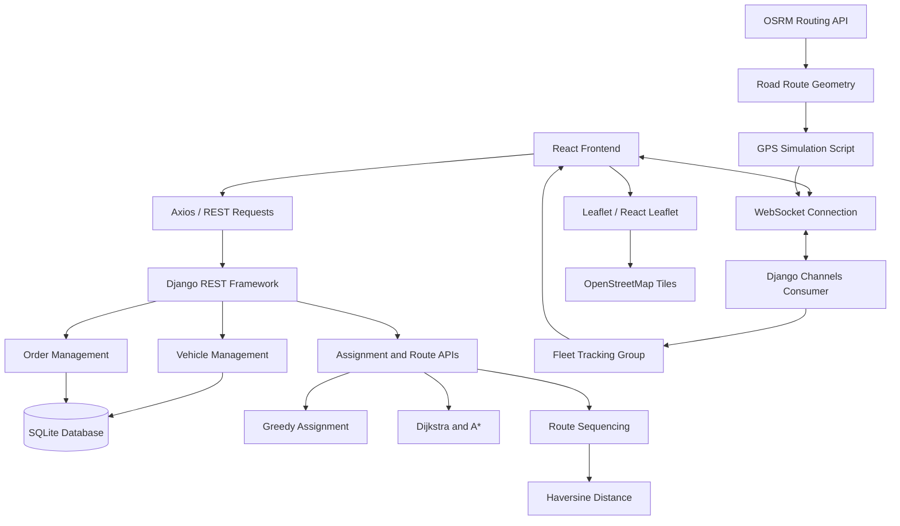
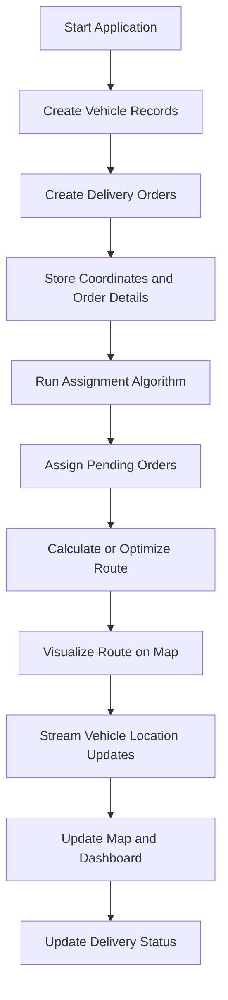

# 🚛 Fleet System — Real-Time Fleet Route Optimization Platform

<p align="center">
  <strong>Smarter Deliveries. Optimized Routes. Real-Time Fleet Visibility.</strong>
</p>

<p align="center">
  A full-stack fleet management platform that combines graph algorithms, route optimization, interactive maps, and WebSocket communication to simulate intelligent delivery operations.
</p>

<p align="center">
  <a href="https://github.com/Hitesh-XS/Fleet_System">GitHub Repository</a>
</p>

---

## 📌 Table of Contents

- [About the Project](#-about-the-project)
- [Problem Statement](#-problem-statement)
- [Project Objectives](#-project-objectives)
- [Features](#-features)
- [Technology Stack](#-technology-stack)
- [System Architecture](#-system-architecture)
- [Project Structure](#-project-structure)
- [Core Algorithms](#-core-algorithms)
- [Database Design](#-database-design)
- [API Documentation](#-api-documentation)
- [Real-Time Vehicle Tracking](#-real-time-vehicle-tracking)
- [Route Optimization](#-route-optimization)
- [Getting Started](#-getting-started)
- [Running the Application](#-running-the-application)
- [Application Workflow](#-application-workflow)
- [Testing and Validation](#-testing-and-validation)
- [Troubleshooting](#-troubleshooting)
- [Future Enhancements](#-future-enhancements)
- [Learning Outcomes](#-learning-outcomes)
- [Contributing](#-contributing)
- [License](#-license)
- [Author](#-author)

---

## 🎯 About the Project

**Fleet System** is a full-stack fleet management and route optimization project designed to demonstrate how software systems can improve delivery planning, vehicle utilization, and operational visibility.

The platform combines a Django backend with a React frontend. It allows fleet operators to manage vehicles and delivery orders, execute assignment logic, compare graph-based pathfinding algorithms, and visualize vehicle locations and routes on an interactive map.

The project brings together several important computer science concepts:

- Full-stack web development
- REST API design
- Database modeling
- Graph theory and shortest-path algorithms
- Greedy optimization heuristics
- Vehicle routing concepts
- Real-time communication using WebSockets
- Geographic visualization
- Route distance calculations

Rather than treating fleet management as a simple CRUD application, Fleet System explores how algorithms and real-time interfaces can work together to support delivery operations.

## ❓ Problem Statement

Delivery and logistics operations involve several interconnected challenges:

- Assigning orders to available vehicles.
- Respecting vehicle capacity constraints.
- Determining efficient routes between locations.
- Monitoring vehicle movement.
- Tracking pending and completed deliveries.
- Understanding fleet utilization and operational status.

Inefficient assignments and delivery sequences can increase travel distance, operational costs, and delivery times.

Fleet System provides a development environment for exploring these problems through vehicle and order management, graph-based pathfinding, greedy assignment, route sequencing, and live location updates.

### Proposed Solution

The system separates fleet operations into a few major responsibilities:

1. **Fleet management:** Maintain vehicle details, capacity, current load, location, and status.
2. **Order management:** Store customer information, coordinates, package weight, priority, and delivery status.
3. **Assignment:** Apply a greedy algorithm to assign pending orders to vehicles.
4. **Pathfinding:** Calculate paths using Dijkstra's algorithm and A* search.
5. **Route optimization:** Evaluate delivery-stop sequences and choose a short route.
6. **Visualization:** Display fleet and delivery information through a React interface and interactive maps.
7. **Real-time tracking:** Broadcast vehicle coordinates to connected clients using WebSockets.

---

## 🎯 Project Objectives

The primary objectives of Fleet System are:

- Build a full-stack fleet management application.
- Develop a REST API using Django REST Framework.
- Create a React-based operational dashboard.
- Manage vehicles and delivery orders using database models.
- Implement Dijkstra's algorithm for shortest-path calculation.
- Implement A* search for heuristic-based pathfinding.
- Use greedy assignment to allocate pending orders.
- Explore delivery sequencing as a Vehicle Routing Problem (VRP).
- Calculate geographical distances between coordinates.
- Integrate OpenStreetMap-based visualization using Leaflet.
- Retrieve real road-route geometry using OSRM.
- Broadcast vehicle location updates through Django Channels.
- Provide a foundation for more advanced routing and logistics optimization.

---

## ✨ Features

### 🚚 1. Fleet Management

Manage vehicle information through the fleet management module.

The vehicle model includes:

- Vehicle registration number.
- Maximum capacity.
- Current load.
- Latitude and longitude.
- Operational status.

Vehicle records can be created, retrieved, updated, and deleted through the Django REST Framework viewset.

### 📦 2. Delivery Order Management

Maintain delivery orders with information such as:

- Customer name.
- Delivery coordinates.
- Package weight.
- Delivery priority.
- Delivery completion status.

Order management provides the data needed by assignment and route-planning components.

### 🧠 3. Greedy Order Assignment

The backend includes a greedy assignment algorithm for allocating pending orders to vehicles.

The assignment endpoint passes vehicle and undelivered-order records to the assignment implementation and returns the resulting assignments.

Greedy methods make decisions using local choices at each step. They are useful for developing practical heuristics, although they do not guarantee a globally optimal solution for every fleet configuration.

### 🗺️ 4. Graph-Based Pathfinding

The project includes implementations of:

- **Dijkstra's algorithm:** Finds a shortest path in a graph with non-negative edge weights.
- **A* search:** Uses a heuristic to guide the search toward a target.

The backend can build a graph from the warehouse and stored order locations, then return pathfinding results and calculated distances.

### 📍 5. Interactive Map

The React frontend uses Leaflet and React Leaflet for geographic visualization.

The project is designed to support:

- Vehicle markers.
- Warehouse locations.
- Customer and delivery locations.
- Route visualization.
- Vehicle movement updates.
- Delivery progress visualization.

The exact map overlays and available interactions depend on the current frontend implementation.

### ⚡ 6. Real-Time Vehicle Tracking

Django Channels provides WebSocket communication for vehicle tracking.

The tracking consumer:

1. Accepts a WebSocket connection.
2. Adds the connection to a fleet-tracking group.
3. Receives vehicle coordinate updates.
4. Broadcasts updates to connected clients.
5. Removes the connection from the group when it disconnects.

The repository also includes `simulate_gps.py`, which requests road geometry from OSRM and sends simulated vehicle positions over a WebSocket connection.

### 🛣️ 7. Route Optimization

The backend includes a route optimization endpoint that evaluates possible delivery-stop permutations and chooses the sequence with the smallest calculated geographic distance from a starting point.

This provides a straightforward way to explore delivery sequencing and optimization.

The current implementation uses Haversine distance rather than road-network distance for the permutation cost. Therefore, the optimized sequence is not necessarily the fastest real-world driving route.

### 📊 8. Dashboard and System Health

The React application includes dashboard and health-related pages.

The backend exposes a health endpoint returning fields for API latency, database connection status, WebSocket status, server load, and uptime.

Some of these values are currently simulated or generated by the endpoint rather than measured from production infrastructure.

---

## 🛠️ Technology Stack

| Technology | Purpose |
|---|---|
| Python | Backend programming language |
| Django 6.0.6 | Web application framework |
| Django REST Framework | REST API and model viewsets |
| Django Channels | WebSocket communication |
| Daphne | ASGI server support |
| SQLite | Development database |
| React 18 | Frontend interface |
| React Router | Frontend navigation |
| Axios | HTTP communication with the backend |
| Leaflet | Interactive map rendering |
| React Leaflet | Leaflet integration with React |
| Chart.js | Data visualization |
| React Chart.js 2 | Chart.js integration with React |
| Framer Motion | Frontend animations |
| Lucide React | Interface icons |
| OpenStreetMap | Map tile data |
| OSRM | Road-route geometry |
| Dijkstra's Algorithm | Graph shortest-path search |
| A* Search | Heuristic pathfinding |
| Greedy Assignment | Order assignment heuristic |
| Haversine Formula | Geographic distance calculation |

---

## 🏗️ System Architecture

Fleet System follows a client-server architecture. The React frontend communicates with the Django backend through HTTP APIs and WebSockets.

### High-Level Architecture



### Architecture Components

#### 1. Frontend Layer

The frontend is built with React and contains pages for dashboard operations, fleet management, orders, maps, and system health.

Axios can be used for HTTP requests, while WebSocket connections support real-time updates.

#### 2. REST API Layer

Django REST Framework provides model viewsets and API endpoints for vehicle records, order records, assignment, pathfinding, route optimization, and system health.

#### 3. Business Logic Layer

The `delivery` Django application contains the vehicle and order models, serializers, views, routing configuration, WebSocket consumer, and algorithm modules.

#### 4. Algorithm Layer

The algorithm modules separate assignment logic from graph pathfinding.

- `assignment.py` contains greedy order assignment logic.
- `pathfinding.py` contains graph and pathfinding implementations.

#### 5. Persistence Layer

SQLite stores vehicle and order records during development.

Django's ORM provides the interface between Python application code and the database.

#### 6. Real-Time Layer

Django Channels receives vehicle coordinates and broadcasts them through a channel group so connected clients can receive updates.

#### 7. Geographic Services

Leaflet displays map information, OpenStreetMap provides map tiles, and OSRM supplies road-route geometry for the GPS simulation script.

---

## 📁 Project Structure

The repository has a Django backend at the root and a React frontend under `frontend/`.

```text
Fleet_System/
│
├── manage.py
├── requirements.txt
├── simulate_gps.py
├── README.md
│
├── delivery/
│   ├── __init__.py
│   ├── admin.py
│   ├── apps.py
│   ├── models.py
│   ├── serializers.py
│   ├── views.py
│   ├── urls.py
│   ├── routing.py
│   ├── consumers.py
│   ├── migrations/
│   └── algorithms/
│       ├── __init__.py
│       ├── assignment.py
│       └── pathfinding.py
│
└── frontend/
    ├── package.json
    ├── package-lock.json
    ├── public/
    └── src/
        ├── App.js
        ├── index.js
        ├── components/
        └── pages/
            ├── Dashboard.jsx
            ├── Health.jsx
            ├── MapPage.jsx
            ├── Orders.jsx
            └── Vehicles.jsx
```

### Important Files

| File | Responsibility |
|---|---|
| `manage.py` | Django command-line entry point |
| `delivery/models.py` | Vehicle and order data models |
| `delivery/serializers.py` | Serialization of model data |
| `delivery/views.py` | REST API endpoints and business logic |
| `delivery/urls.py` | Delivery API URL patterns |
| `delivery/consumers.py` | WebSocket tracking consumer |
| `delivery/routing.py` | WebSocket routing configuration |
| `delivery/algorithms/assignment.py` | Greedy order assignment |
| `delivery/algorithms/pathfinding.py` | Graph, Dijkstra, and A* implementations |
| `simulate_gps.py` | Simulates vehicle movement along an OSRM road route |
| `frontend/src/App.js` | Main React application component |
| `frontend/src/pages/Dashboard.jsx` | Dashboard interface |
| `frontend/src/pages/Vehicles.jsx` | Vehicle management interface |
| `frontend/src/pages/Orders.jsx` | Order management interface |
| `frontend/src/pages/MapPage.jsx` | Map and route visualization |
| `frontend/src/pages/Health.jsx` | System health interface |

---

## 🧠 Core Algorithms

### 1. Dijkstra's Algorithm

Dijkstra's algorithm finds the shortest path from a starting node to other reachable nodes in a weighted graph with non-negative edge weights.

It repeatedly selects the unvisited node with the smallest known distance and relaxes the edges leaving that node.

**Typical applications:**

- Finding shortest paths between warehouse and delivery locations.
- Comparing alternative graph routes.
- Calculating minimum graph distance.

With an adjacency-list graph and a min-priority queue, its usual time complexity is:

\[
O((V+E)\log V)
\]

Where \(V\) is the number of vertices and \(E\) is the number of edges.

### 2. A* Search Algorithm

A* combines the known cost from the starting point with a heuristic estimate of the remaining cost to the target.

Its evaluation function is:

\[
f(n)=g(n)+h(n)
\]

Where:

- \(g(n)\) is the cost from the start to node \(n\).
- \(h(n)\) estimates the remaining cost from \(n\) to the destination.
- \(f(n)\) determines the priority for exploring a node.

A* can explore fewer nodes than Dijkstra's algorithm when the heuristic is informative and appropriately designed.

Its performance depends on the graph, implementation, and heuristic. A* is guaranteed to return an optimal path under suitable conditions, including an admissible heuristic and correct graph-search handling.

### 3. Greedy Vehicle Assignment

The assignment module uses a greedy approach to allocate orders to vehicles.

A typical greedy assignment process is:

1. Retrieve available vehicle records.
2. Retrieve pending delivery orders.
3. Evaluate candidate vehicle-order assignments.
4. Select an assignment according to the implemented heuristic.
5. Update assignment state or produce an assignment result.
6. Return the assignments through the API.

Greedy algorithms are generally easier to implement and fast to execute, but their output depends on the local decision rule and may not be globally optimal.

### 4. Vehicle Routing Problem

The Vehicle Routing Problem (VRP) concerns assigning a set of delivery stops to vehicles while optimizing an objective such as total distance or travel time.

Realistic VRP formulations may include:

- Vehicle capacity constraints.
- Different delivery priorities.
- Time windows.
- Multiple warehouses.
- Driver working hours.
- Traffic conditions.
- Vehicle availability.

Fleet System provides a foundation for experimenting with vehicle assignment and route sequencing. A complete VRP solver would require additional constraints and optimization logic.

### 5. Nearest-Neighbor and Greedy Heuristics

A nearest-neighbor heuristic selects a nearby unvisited stop at each step. It can quickly construct a feasible route and can serve as a baseline for more advanced optimization.

The exact route-selection behavior depends on the algorithm implemented.

### 6. Haversine Distance

The Haversine formula calculates the great-circle distance between two latitude/longitude coordinates on a spherical approximation of Earth.

For two points, the formula uses their latitude and longitude differences to estimate geographic distance.

The implementation in the route optimization endpoint uses this formula to compare stop sequences.

**Important distinction:** straight-line geographic distance is not the same as road-network distance. Actual driving routes may be longer because of road geometry, one-way streets, restricted turns, and other constraints.

---

## 🗄️ Database Design

The project currently uses SQLite through Django's ORM.

### Vehicle Model

The `Vehicle` model includes the following fields:

| Field | Type | Description |
|---|---|---|
| `vehicle_number` | Character field | Unique vehicle identifier |
| `capacity` | Integer | Maximum vehicle capacity |
| `current_load` | Integer | Current load, defaulting to zero |
| `latitude` | Float | Vehicle latitude |
| `longitude` | Float | Vehicle longitude |
| `status` | Character field | Vehicle operational status |

The vehicle number is configured as unique.

### Order Model

The `Order` model contains:

| Field | Type | Description |
|---|---|---|
| `customer_name` | Character field | Customer associated with the order |
| `latitude` | Float | Delivery latitude |
| `longitude` | Float | Delivery longitude |
| `weight` | Integer | Package weight |
| `priority` | Integer | Order priority value |
| `delivered` | Boolean | Whether the order has been delivered |

The `delivered` field defaults to `False`.

### Data Relationships

The current models define vehicle and order records independently. The shown `Order` model does not contain a vehicle foreign key, so the schema itself does not persist a direct vehicle-to-order relationship.

The assignment endpoint returns assignment results from the algorithm. Persisting assignments and tracking their history would be a useful future improvement.

---

## 🔌 API Documentation

The backend exposes REST endpoints through Django REST Framework.

The following endpoints are defined in `delivery/urls.py`. The examples assume the delivery URL configuration is included at the project root as `/`; the final paths depend on the root URL configuration.

Base URL for local development:

```text
http://127.0.0.1:8000
```

### API Endpoints

| Method | Endpoint | Purpose |
|---|---|---|
| GET | `/api/vehicles/` | List vehicles |
| POST | `/api/vehicles/` | Create a vehicle |
| GET | `/api/vehicles/{id}/` | Retrieve a vehicle |
| PUT / PATCH | `/api/vehicles/{id}/` | Update a vehicle |
| DELETE | `/api/vehicles/{id}/` | Delete a vehicle |
| GET | `/api/orders/` | List orders |
| POST | `/api/orders/` | Create an order |
| GET | `/api/orders/{id}/` | Retrieve an order |
| PUT / PATCH | `/api/orders/{id}/` | Update an order |
| DELETE | `/api/orders/{id}/` | Delete an order |
| GET | `/api/routes/` | Route endpoint placeholder |
| POST | `/api/assign/` | Execute greedy assignment |
| GET | `/api/algorithms/` | Run Dijkstra and A* comparison |
| GET | `/api/health/` | Return system health information |
| POST | `/api/optimize/` | Optimize a sequence of delivery stops |

**Note:** The algorithm endpoint is currently registered in the repository as `api/ algorithms/`, with an unintended space. Remove that space in `delivery/urls.py` if you want the intended `/api/algorithms/` URL shown above.

### 1. Vehicle Management

Example request:

```http
GET /api/vehicles/
```

Returns the vehicle records available in the database.

To create a vehicle, send a JSON body containing the fields required by the model and serializer.

Example payload:

```json
{
  "vehicle_number": "MH-02-MD02",
  "capacity": 100,
  "current_load": 0,
  "latitude": 19.113,
  "longitude": 72.869,
  "status": "available"
}
```

The accepted field values depend on the serializer and model validation.

### 2. Order Management

Example request:

```http
GET /api/orders/
```

Example payload:

```json
{
  "customer_name": "Sample Customer",
  "latitude": 19.0176,
  "longitude": 72.8561,
  "weight": 10,
  "priority": 1,
  "delivered": false
}
```

Use your own delivery coordinates and package information when creating records.

### 3. Assignment Endpoint

Request:

```http
POST /api/assign/
```

This endpoint retrieves vehicle records and undelivered orders, invokes `assign_orders_greedy`, and returns the number of assignments along with the assignment results.

If either vehicles or pending orders are missing, the endpoint returns a message explaining that both are required.

### 4. Pathfinding Endpoint

Request:

```http
GET /api/algorithms/
```

The endpoint requires at least two order records.

It builds a graph containing a warehouse node and order nodes, runs Dijkstra's algorithm and A*, and returns the computed paths and distances.

The current graph construction connects the warehouse to each order and connects orders to each other. These are generated graph connections; they should not be interpreted as a verified road-network graph.

### 5. Route Optimization Endpoint

Request:

```http
POST /api/optimize/
Content-Type: application/json
```

Example payload:

```json
{
  "start": {
    "lat": 19.076,
    "lng": 72.8777
  },
  "stops": [
    {
      "id": 1,
      "lat": 19.113,
      "lng": 72.869
    },
    {
      "id": 2,
      "lat": 19.0176,
      "lng": 72.8561
    }
  ]
}
```

The endpoint evaluates permutations of the supplied stops and returns the best sequence found according to the calculated Haversine distance.

Because it checks every permutation, the approach becomes computationally expensive as the number of stops grows.

### 6. Health Endpoint

Request:

```http
GET /api/health/
```

The response includes fields such as:

```json
{
  "api_latency_ms": 42,
  "db_connection": "Healthy",
  "ws_status": "Connected",
  "server_load": 12,
  "uptime_seconds": 1000
}
```

The values above are illustrative. The current endpoint generates some health values synthetically rather than measuring actual infrastructure metrics.

---

## ⚡ Real-Time Vehicle Tracking

Fleet System uses Django Channels to communicate vehicle location updates over WebSockets.

### WebSocket Endpoint

The GPS simulation script connects to:

```text
ws://127.0.0.1:8000/ws/tracking/
```

This assumes the project-level ASGI routing exposes the `TrackingConsumer` at that path.

### Tracking Workflow

1. A WebSocket client connects to the tracking endpoint.
2. The consumer joins the `fleet_tracking` channel group.
3. The client sends a vehicle identifier and coordinates.
4. The consumer broadcasts the location update to the group.
5. Connected clients receive the vehicle identifier, latitude, and longitude.
6. The frontend can use the data to update the vehicle marker on the map.

### Example Location Message

```json
{
  "vehicle": "MH-02-MD02",
  "lat": 19.113,
  "lng": 72.869
}
```

### GPS Simulation

The root-level `simulate_gps.py` script:

1. Requests driving-route geometry from the public OSRM routing service.
2. Retrieves the route as GeoJSON coordinates.
3. Converts longitude/latitude order into latitude/longitude order for Leaflet.
4. Connects to the WebSocket tracking endpoint.
5. Sends successive route waypoints as vehicle location updates.
6. Waits briefly between waypoints to simulate movement.

The current example simulates a vehicle travelling between two locations in Mumbai.

**Important:** This is simulated GPS movement, not live hardware GPS tracking. The script requires the Django application, a working WebSocket route, and access to the OSRM service.

---

## 🛣️ Route Optimization

The route optimization endpoint accepts a starting location and a collection of delivery stops.

### Input

- A starting coordinate represented by latitude and longitude.
- A list of stops, each with an identifier and coordinates.

### Processing

1. Generate possible permutations of the supplied stops.
2. Start from the given starting coordinate.
3. Calculate the distance from the current location to the next stop.
4. Sum the distances across the sequence.
5. Compare the sequence against the best distance found so far.
6. Return the best sequence and its total distance.

### Complexity

For \(n\) stops, there are \(n!\) possible sequences. Evaluating each sequence takes approximately \(O(n)\) work, resulting in:

\[
O(n\cdot n!)
\]

This is practical only for small numbers of stops.

### Limitations

- The current cost function uses straight-line geographic distance.
- It does not account for real driving time or traffic.
- It does not currently model time windows or vehicle capacity in the route sequence.
- The request handler expects valid JSON containing `start` and `stops`.
- Empty stop lists and malformed input should be validated explicitly for a more robust API.

For larger routing problems, consider nearest-neighbor initialization, local search, genetic algorithms, simulated annealing, or dedicated VRP optimization libraries.

---

## 🚀 Getting Started

Follow these instructions to run the project locally.

### Prerequisites

Install:

- Python compatible with Django 6.0 — Python 3.12 or newer.
- Node.js and npm.
- Git.
- A modern web browser.
- An internet connection for map tiles and OSRM route requests.

Check your versions:

```bash
python --version
node --version
npm --version
```

### Step 1: Clone the Repository

```bash
git clone https://github.com/Hitesh-XS/Fleet_System.git
cd Fleet_System
```

### Step 2: Create a Python Virtual Environment

**Windows — PowerShell**

```powershell
python -m venv .venv
.\.venv\Scripts\Activate.ps1
```

**Windows — Command Prompt**

```cmd
python -m venv .venv
.venv\Scripts\activate.bat
```

**Linux or macOS**

```bash
python3 -m venv .venv
source .venv/bin/activate
```

### Step 3: Install Backend Dependencies

Install the dependencies listed in `requirements.txt`:

```bash
python -m pip install --upgrade pip
pip install -r requirements.txt
```

The repository's requirements include Django, Django REST Framework, Django Channels, Daphne, and supporting packages.

### Step 4: Apply Database Migrations

```bash
python manage.py migrate
```

If you change Django models and need to create migration files:

```bash
python manage.py makemigrations
python manage.py migrate
```

### Step 5: Start the Django Backend

```bash
python manage.py runserver
```

The backend normally runs at:

```text
http://127.0.0.1:8000/
```

Keep this terminal open while using the frontend.

### Step 6: Install Frontend Dependencies

Open a second terminal and navigate to the frontend directory:

```bash
cd frontend
npm install
```

### Step 7: Start the React Frontend

```bash
npm start
```

The React development server normally opens at:

```text
http://localhost:3000/
```

If the browser does not open automatically, enter the address manually.

### Step 8: Verify the Application

Check that:

- The Django backend starts without errors.
- The React frontend compiles successfully.
- Vehicle and order pages can load their data.
- API requests reach the backend.
- The map displays its configured map tiles.
- The WebSocket tracking connection works.
- The GPS simulator can retrieve an OSRM route and send location updates.

---

## 🔄 Application Workflow

A typical fleet-management workflow is:



### Step-by-Step Explanation

**1. Register vehicles**

Create vehicle records with their identifiers, capacities, coordinates, and statuses.

**2. Create orders**

Enter customer names, delivery coordinates, weights, and priorities.

**3. Assign orders**

Call the assignment endpoint to run the greedy assignment logic against available vehicle and pending-order records.

**4. Calculate routes**

Use the pathfinding endpoint to compare graph paths or the optimization endpoint to find a short stop sequence.

**5. Visualize routes**

Display geographic locations and route information through the React map interface.

**6. Simulate vehicle movement**

Run the GPS simulation script to send successive road-route coordinates to the tracking WebSocket.

**7. Monitor operations**

Review fleet, order, map, and health information through the available frontend pages.

---

## 🧪 Testing and Validation

Django provides built-in commands to check the project and run its test suite.

### Check Django Configuration

```bash
python manage.py check
```

### Run Backend Tests

```bash
python manage.py test
```

### Inspect Database Migrations

```bash
python manage.py showmigrations
```

### Validate Installed Dependencies

```bash
pip check
```

### Build the Frontend

From the `frontend` directory:

```bash
npm run build
```

### Test the API

You can open the following endpoint in a browser after starting Django:

```text
http://127.0.0.1:8000/api/vehicles/
```

You can also use Postman, curl, or another HTTP client to test GET and POST endpoints.

**Note:** These commands describe ways to validate the project. A successful result depends on the current configuration and test coverage.

---

## 🐛 Troubleshooting

### 1. Django Cannot Import the Settings Module

The repository's `manage.py` configures:

```python
DJANGO_SETTINGS_MODULE = "fleet_system.settings"
```

If Django reports that `fleet_system.settings` cannot be imported, verify that the corresponding Python package exists in the working directory and that its files are named correctly.

### 2. Missing Python Dependencies

Activate the virtual environment and run:

```bash
pip install -r requirements.txt
pip check
```

### 3. React Frontend Does Not Start

From the `frontend` directory, run:

```bash
npm install
npm start
```

Check the terminal output for missing dependencies or compilation errors.

### 4. API Requests Fail

Check that:

- Django is running.
- The frontend is requesting the correct backend URL.
- The URL paths match `delivery/urls.py` and the project-level URL configuration.
- Cross-origin settings permit the frontend origin when needed.
- The request method and payload match the endpoint's requirements.

### 5. WebSocket Connection Fails

Verify that:

- The backend's ASGI application is configured correctly.
- The tracking route is registered at `/ws/tracking/`.
- Django Channels is installed.
- The server supports ASGI and the configured channel layer is available.
- The client uses `ws://` locally and an appropriate secure WebSocket URL in production.

### 6. Map Tiles Do Not Load

Check your internet connection, the Leaflet CSS configuration, and the OpenStreetMap tile URL used by the frontend.

Follow the relevant map tile provider's usage policy.

### 7. OSRM Route Request Fails

The GPS simulation depends on a public OSRM routing endpoint. A request can fail because of network connectivity, service availability, rate limits, or invalid coordinates.

Check the response before accessing the returned route geometry.

### 8. Assignment Returns No Results

The assignment endpoint requires both vehicle records and pending orders.

Create at least one vehicle and one order with `delivered` set to `false`, then call the assignment endpoint again.

### 9. Pathfinding Requires More Orders

The algorithm endpoint currently requires at least two order records. Create sufficient test data before running the pathfinding comparison.

### 10. Route Optimization Becomes Slow

The current optimization endpoint evaluates all permutations. Its runtime grows factorially with the number of stops.

Use a small number of stops for testing, and consider more scalable heuristics for larger workloads.

---

## 🚧 Future Enhancements

The following improvements could extend the project:

### Optimization

- [ ] Implement a complete capacity-constrained Vehicle Routing Problem solver.
- [ ] Add nearest-neighbor route construction.
- [ ] Add 2-opt or other local-search improvements.
- [ ] Explore genetic algorithms and simulated annealing.
- [ ] Use road-network travel time rather than straight-line distance.
- [ ] Support delivery time windows and multiple warehouses.

### Fleet Management

- [ ] Persist vehicle-order assignments in the database.
- [ ] Track assignment history.
- [ ] Add driver and vehicle availability constraints.
- [ ] Add validation for vehicle capacity and order weight.
- [ ] Add delivery lifecycle states and audit history.

### Real-Time Tracking

- [ ] Connect live GPS hardware or a mobile tracking client.
- [ ] Add authenticated WebSocket connections.
- [ ] Validate incoming coordinates and vehicle identifiers.
- [ ] Add persistent location history.
- [ ] Add automatic route recalculation when a vehicle deviates from its route.

### Analytics

- [ ] Measure actual API latency and database health.
- [ ] Track vehicle utilization and delivery success rates.
- [ ] Calculate route efficiency and total distance travelled.
- [ ] Add operational reports and export functionality.
- [ ] Improve monitoring and logging.

### Production Readiness

- [ ] Add comprehensive automated tests.
- [ ] Configure production-grade database storage.
- [ ] Add secure configuration management.
- [ ] Add API authentication and authorization.
- [ ] Add rate limiting and request validation.
- [ ] Configure CI/CD and deployment automation.

---

## 📚 Learning Outcomes

This project demonstrates practical experience with:

- Full-stack web application development.
- Django and Django REST Framework.
- React component-based development.
- REST API integration.
- Django ORM and relational data modeling.
- Graph representation and shortest-path algorithms.
- Dijkstra's algorithm and A* search.
- Greedy assignment heuristics.
- Combinatorial optimization and the Vehicle Routing Problem.
- Geographic distance calculations.
- Interactive map integration.
- WebSocket communication and event broadcasting.
- Simulated GPS data streaming.
- Frontend dashboards and data visualization.
- API testing and application debugging.

---

## 🌍 Real-World Applications

The concepts explored in Fleet System are relevant to:

- Courier and parcel delivery.
- E-commerce logistics.
- Last-mile delivery operations.
- Warehouse dispatch planning.
- Service and maintenance fleets.
- Food delivery operations.
- Vehicle tracking dashboards.
- Transportation planning.
- Fleet utilization analysis.

Fleet System is an educational and portfolio project, not a production logistics service. Real-world deployment would require additional validation, security controls, reliable routing data, and operational monitoring.

---

## 📸 Screenshots

Screenshots can be added here as the project evolves.

Suggested screenshots:

- Main dashboard.
- Vehicle management page.
- Order management page.
- Interactive fleet map.
- Route optimization results.
- Dijkstra and A* comparison.
- Real-time vehicle tracking.
- System health dashboard.

For example, if screenshots are stored in a `screenshots/` directory, add them using Markdown:

```markdown

```

---

## 🤝 Contributing

Contributions, improvements, bug reports, and suggestions are welcome.

### Contribution Steps

1. Fork the repository.
2. Clone your fork.
3. Create a feature branch.
4. Implement your changes.
5. Run the relevant backend checks and frontend build.
6. Commit your changes.
7. Push the branch to your fork.
8. Open a pull request describing the changes.

Create a branch:

```bash
git checkout -b feature/your-feature
```

Validate the backend:

```bash
python manage.py check
python manage.py test
```

Validate the frontend:

```bash
cd frontend
npm run build
```

Please keep changes focused, document new endpoints, and avoid committing credentials, local environment files, or generated artifacts.

---

## 📄 License

This repository does not currently declare a standard open-source license.

The project may be used for educational and portfolio purposes, but permission to reuse, modify, or redistribute the code should be determined from the repository's actual license terms. Add a `LICENSE` file if you intend to publish the project under a specific open-source license.

---

## 👨‍💻 Author

**GAIKAR SUNIL**

- GitHub: [Hitesh-XS](https://github.com/Hitesh-XS)
- Repository: [Fleet_System](https://github.com/Hitesh-XS/Fleet_System)

---

<p align="center">
  <strong>🚛 Fleet System — Bringing algorithms and real-time visibility to fleet operations.</strong>
</p>
